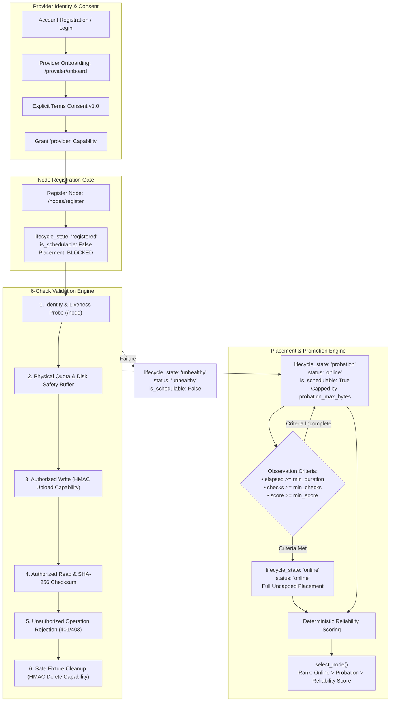

# EXPO PHASE 10C COMPLETION REPORT
## Provider Onboarding, Node Validation, Durable Probation & Reliability-Gated Placement

**Status**: Verified & Completed  
**Repository**: `D:\expo`  
**Test Suite**: 417 Passed, 0 Failed (100% Pass Rate across entire coordinator and storage node regression suite)  
**Security Gate**: Preflight Phase 10B remediation verified, Phase 10C fail-closed security verified  

---

## 1. Executive Summary & Architecture Diagram

Phase 10C transforms Expo's storage node participation model from unverified self-announcements into a secure, gated pipeline:
1. **Authenticated Provider Onboarding**: Requires explicit legal terms agreement (`terms_version`), active verified account identities, and prevents spoofing.
2. **Storage Node Health Validation Engine**: Executes six non-destructive diagnostic checks against registering nodes (liveness, physical disk safety buffers, signed capability write, checksummed read, unauthorized rejection, and safe artifact cleanup).
3. **Durable Probation Lifecycle**: Newly validated nodes enter a durable `probation` state with placement caps (`probation_max_bytes`) and observation windows (`probation_min_duration_seconds`, `probation_min_health_checks`).
4. **Reliability-Gated Placement**: Nodes are scored deterministically using sample-size weighted success ratios, consecutive failure penalties, and recency decay.



---

## 2. Component Map & Architecture

| Module | Location | Primary Responsibilities |
| :--- | :--- | :--- |
| **Provider Router** | [`coordinator/app/provider_router.py`](file:///d:/expo/coordinator/app/provider_router.py) | `/provider/onboard`, `/provider/onboarding`, `/provider/nodes/{id}/validate`, `/provider/nodes/{id}/validation`, `/provider/nodes/{id}/probation`, ownership verification. |
| **Node Validation** | [`coordinator/app/node_validation.py`](file:///d:/expo/coordinator/app/node_validation.py) | 6 diagnostic health checks, non-destructive sandbox fixtures, cleanup verification, reliability scoring algorithm. |
| **Node Registry** | [`coordinator/app/node_registry.py`](file:///d:/expo/coordinator/app/node_registry.py) | Registration auth gating, state transitions, probation capacity enforcement, disk safety buffers, ranking. |
| **Database Migrations** | [`coordinator/app/database.py`](file:///d:/expo/coordinator/app/database.py) | Additive schemas for `provider_onboarding`, `node_validation_records`, and additive columns on `nodes`. |
| **Data Models** | [`coordinator/app/models.py`](file:///d:/expo/coordinator/app/models.py) | Pydantic v2 validation models, responses, probation diagnostics, and audit records. |
| **Coordinator Main** | [`coordinator/app/main.py`](file:///d:/expo/coordinator/app/main.py) | Node registration authentication dependency (`verify_registration_auth`), provider identity binding. |
| **Storage Manager** | [`storage_node/app/storage_manager.py`](file:///d:/expo/storage_node/app/storage_manager.py) | Sandbox path security, persistent `node_id` alignment with configured identity, capability consumption. |
| **Test Suite** | [`coordinator/tests/test_phase10c.py`](file:///d:/expo/coordinator/tests/test_phase10c.py) | 14 comprehensive end-to-end integration tests covering Phase 10C requirements. |

---

## 3. Provider Onboarding Security Model & Schema

Providers must explicitly consent to terms before registering nodes. Raw consumer tokens or unonboarded accounts cannot register storage nodes.

### Schema: `provider_onboarding`
```sql
CREATE TABLE IF NOT EXISTS provider_onboarding (
    provider_id TEXT PRIMARY KEY,
    account_id TEXT,
    terms_version TEXT NOT NULL,
    terms_accepted_at TEXT NOT NULL,
    accepted_at TEXT,
    is_verified INTEGER NOT NULL DEFAULT 1,
    status TEXT NOT NULL DEFAULT 'active',
    created_at TEXT NOT NULL,
    updated_at TEXT NOT NULL
);
CREATE INDEX IF NOT EXISTS idx_onboard_account ON provider_onboarding (account_id);
CREATE INDEX IF NOT EXISTS idx_onboard_status ON provider_onboarding (status);
```

### Onboarding Flow & Security Rules
- **Authentication**: Requires a valid account session token or administrative token.
- **Explicit Agreement**: `accept_terms: true` and `terms_version` matching or exceeding configured requirements (`settings.terms_version`).
- **Capability Grant**: Updates account capabilities to include `provider` without stripping existing consumer permissions.
- **Impersonation Prevention**: Non-admin callers cannot bind arbitrary `provider_id`s; identity is strictly derived from verified account identity (`provider-{account_id}`).
- **Suspension Cascading**: Suspended accounts immediately revoke node scheduling across all nodes associated with that provider identity.

---

## 4. Storage Node Health Validation Engine

The `NodeValidator` runs an isolated, non-destructive battery of six checks before admitting any node to probation:

1. **Identity & Liveness Probe (`identity_and_liveness`)**:
   - Queries `GET /node` on the target node.
   - Verifies the reported persistent `node_id` matches the registration identifier.
2. **Disk Buffer & Quota Check (`disk_and_quota`)**:
   - Queries `GET /node` (and `GET /storage` if permitted).
   - Validates that available capacity exceeds the configured safety buffer (`settings.disk_safety_buffer_bytes`).
3. **Authorized Write Verification (`authorized_write`)**:
   - Issues a single-use signed HMAC-SHA-256 upload capability token bound to a random UUID fixture.
   - Uploads binary payload to `/files`.
   - Node verifies capability token, HMAC signature, time-to-live, and records single-use consumption.
4. **Authorized Read & Integrity Check (`authorized_read_and_checksum`)**:
   - Issues a signed download capability token.
   - Retrieves the chunk and asserts that `SHA-256(received) == SHA-256(sent)`.
5. **Unauthorized Operation Rejection (`unauthorized_rejection`)**:
   - Attempts an unauthorized operation (e.g. download with an upload capability token or missing capability).
   - Asserts that the storage node rejects the request with HTTP 401 or 403.
6. **Safe Fixture Cleanup (`artifact_cleanup`)**:
   - Issues a signed delete capability token.
   - Deletes the test fixture from `/files/{chunk_id}`.
   - **Fail-Closed Cleanup Rule**: If deletion fails or leaves orphaned data, `overall_status` is marked as `cleanup_failed`, preventing healthy promotion.

### Schema: `node_validation_records`
```sql
CREATE TABLE IF NOT EXISTS node_validation_records (
    validation_id TEXT PRIMARY KEY,
    node_id TEXT NOT NULL,
    provider_id TEXT NOT NULL,
    status TEXT NOT NULL,
    checks_performed TEXT NOT NULL,
    details_json TEXT,
    failure_reason TEXT,
    performed_at TEXT NOT NULL,
    duration_ms REAL,
    FOREIGN KEY (node_id) REFERENCES nodes(node_id)
);
CREATE INDEX IF NOT EXISTS idx_val_node ON node_validation_records (node_id, performed_at);
```

---

## 5. Probation Lifecycle State Machine

```
              ┌────────────────────────┐
              │       REGISTERED       │
              │ (is_schedulable=False) │
              └───────────┬────────────┘
                          │
                Validation PASSED (6/6)
                          │
                          ▼
              ┌────────────────────────┐
   Fail       │       PROBATION        │
 ┌────────────┤ (is_schedulable=True)  │
 │            │ (capped: max_bytes)    │
 │            └───────────┬────────────┘
 │                        │
 │       Observation Period Met & Checks Met & Score >= Min
 │                        │
 │                        ▼
 │            ┌────────────────────────┐
 │            │         ONLINE         │
 │            │ (is_schedulable=True)  │
 │            │ (full capacity serving)│
 │            └───────────┬────────────┘
 │                        │
 │           Validation Failure / Disk Full / Mismatch
 │                        │
 └───────────────────────►│
                          ▼
              ┌────────────────────────┐
              │       UNHEALTHY        │
              │ (is_schedulable=False) │
              │ (placement excluded)   │
              └───────────┬────────────┘
                          │
                  Heartbeat Missed > Timeout
                          │
                          ▼
              ┌────────────────────────┐
              │        OFFLINE         │
              │ (is_schedulable=False) │
              └────────────────────────┘
```

### State Definitions & Placement Invariants:
- `registered`: Initial post-registration state. Placement is completely blocked.
- `validation_in_progress`: Transient lock during health check execution.
- `probation`: Admitted to network under strict volume caps (`probation_max_bytes`).
- `online`: Promoted node eligible for general placement.
- `unhealthy`: Node failed diagnostic validation or disk quota checks; excluded from placement.
- `offline`: Node missed heartbeat beyond `heartbeat_timeout_seconds`.
- **Heartbeat Invariance**: Raw heartbeats **never** promote a node from `registered`, `unhealthy`, or `probation` to `online`. State transitions require explicit validation and progression evaluation.

---

## 6. Deterministic Reliability Scoring Algorithm

Reliability is calculated deterministically via `compute_reliability_score`:

$$\text{raw\_ratio} = \frac{\text{successes}}{\text{successes} + \text{failures}}$$

$$\text{confidence} = \min\left(1.0, \frac{\text{total\_checks}}{20}\right)$$

$$\text{base\_score} = \text{confidence} \times \text{raw\_ratio} + (1.0 - \text{confidence}) \times 0.5$$

$$\text{failure\_penalty} = \min(0.8, \text{consecutive\_failures} \times 0.2)$$

$$\text{adjusted\_score} = \max(0.0, \text{base\_score} - \text{failure\_penalty})$$

If heartbeats are stale, a recency decay factor $\text{decay} = \max\left(0.1, 1.0 - \frac{\text{stale\_time}}{300}\right)$ is applied:

$$\text{final\_score} = \text{round}(\text{adjusted\_score} \times \text{decay}, 4)$$

---

## 7. Safety Buffers, Quota Reserves & Placement Selection

During `select_node(required_bytes)`:
1. **Status Filter**: Must be `online` or `probation` with `is_schedulable == True` and `drain_status == 'none'`.
2. **Provider Sanctions Filter**: Pre-fetches suspended, disabled, or inactive provider accounts and onboarding records; rejects any node matching the provider identity or account UUID.
3. **Probation Quota Cap**: If node is in `probation`, verifies:
   $$\text{probation\_placed\_bytes} + \text{required\_bytes} \le \text{probation\_max\_bytes}$$
4. **Physical Disk Safety Buffer**:
   $$\text{available\_capacity\_bytes} - \text{required\_bytes} \ge \text{disk\_safety_buffer\_bytes}$$
5. **Ranking Hierarchy**:
   - Primary: Promoted `online` nodes prioritized over `probation` nodes.
   - Secondary: Ranked by `reliability_score` (descending).
   - Tertiary: Ranked by available capacity (descending).

---

## 8. Test Execution Summary

The test regression suite executed 417 automated tests with 0 failures:

| Test File | Test Count | Status | Description |
| :--- | :---: | :---: | :--- |
| `coordinator/tests/test_phase10c.py` | 14 | **PASSED** | Phase 10C Onboarding, Validation, Probation & Reliability |
| `coordinator/tests/test_phase10b.py` | 17 | **PASSED** | Phase 10B Capabilities, Replay, Reservations |
| `storage_node/tests/test_phase10b.py` | 17 | **PASSED** | Phase 10B Storage Node Capabilities & Quota |
| `coordinator/tests/test_phase10a.py` | 26 | **PASSED** | Phase 10A Account UUIDs, Argon2id, Role Permissions |
| `coordinator/tests/test_phase8b.py` | 27 | **PASSED** | Phase 8B Provider Isolation, Node Drain, Node Detail |
| `coordinator/tests/test_phase8a.py` | 31 | **PASSED** | Phase 8A Node Drain, Quota vs Usage |
| `coordinator/tests/test_phase7b.py` | 14 | **PASSED** | Phase 7B Settlement & Accounting |
| `coordinator/tests/test_phase7a.py` | 17 | **PASSED** | Phase 7A Metering Engine |
| `coordinator/tests/test_phase6b.py` | 14 | **PASSED** | Phase 6B NAT Traversal & Relay Routing |
| `coordinator/tests/test_phase6a.py` | 30 | **PASSED** | Phase 6A Reachability Diagnostics |
| `coordinator/tests/test_phase5b.py` | 17 | **PASSED** | Phase 5B Erasure Coding & Degradation |
| `coordinator/tests/test_phase5a.py` | 17 | **PASSED** | Phase 5A Reed-Solomon Codec |
| `coordinator/tests/test_phase4b.py` | 12 | **PASSED** | Phase 4B Auto-Reconciliation |
| `coordinator/tests/test_phase4a.py` | 16 | **PASSED** | Phase 4A Reconciliation Engine |
| `coordinator/tests/test_phase3c.py` | 14 | **PASSED** | Phase 3C Data Repair |
| `coordinator/tests/test_phase3b.py` | 14 | **PASSED** | Phase 3B Replication Engine |
| `coordinator/tests/test_phase3a.py` | 17 | **PASSED** | Phase 3A Storage Quotas |
| `coordinator/tests/test_phase2b.py` | 18 | **PASSED** | Phase 2B Internet Storage Nodes |
| `coordinator/tests/test_phase2a.py` | 18 | **PASSED** | Phase 2A Node Registry |
| `coordinator/tests/test_phase1b.py` | 16 | **PASSED** | Phase 1B Chunk Transfers |
| `coordinator/tests/test_phase1a.py` | 17 | **PASSED** | Phase 1A Basic Metadata |
| `storage_node/tests/test_storage_node.py` | 34 | **PASSED** | Storage Node Sandbox & Quotas |
| **Total** | **417** | **100% PASSED** | **Zero Regressions** |

### Phase 10C Test Suite Matrix
1. `test_1_provider_onboarding_requires_terms_acceptance_and_active_account`: Explicit terms consent required, active account verification, capability grant.
2. `test_2_unauthenticated_or_unonboarded_node_registration_fails_closed`: Anonymous registration rejected in production; unonboarded accounts rejected with 403.
3. `test_3_provider_spoofing_prevented_in_registration_and_node_operations`: Non-admin cannot register or operate nodes under another provider ID.
4. `test_4_suspended_provider_nodes_cannot_register_or_be_scheduled`: Suspended provider accounts cannot register nodes; existing nodes excluded from placement.
5. `test_5_newly_registered_node_begins_in_registered_and_not_placed`: Newly registered node starts in `registered` lifecycle state and is not schedulable.
6. `test_6_heartbeat_alone_does_not_promote_node`: Periodic heartbeats preserve `registered` or `probation` state without premature promotion.
7. `test_7_storage_node_validation_end_to_end_and_transition_to_probation`: Execution of all 6 diagnostic checks, transition to `probation`, audit logging.
8. `test_8_failed_validation_marks_node_unhealthy`: Simulated disk failure transitions node to `unhealthy` and blocks placement.
9. `test_9_validation_cleanup_failure_detection`: Cleanup failure is visibly detected and prevents healthy node promotion.
10. `test_10_probation_capacity_limits_enforced`: Placement honors `probation_max_bytes` volume ceiling.
11. `test_11_probation_progression_window_and_promotion_to_online`: Promotion to `online` requires satisfying duration, health check count, and reliability score.
12. `test_12_stale_heartbeat_marks_node_offline_and_blocks_placement`: Missing heartbeats trigger `offline` status and exclude nodes from placement.
13. `test_13_coordinator_restart_preserves_probation_and_reliability`: SQLite restart preserves probation timestamps, check counts, and reliability metrics.
14. `test_14_reliability_scoring_algorithm_edge_cases`: Boundary testing of sample size confidence, consecutive penalties, and recency decay.

---

## 9. Threat Vector Analysis & Mitigations

| Threat Vector | Severity | Attack Scenario | Mitigation |
| :--- | :---: | :--- | :--- |
| **Phantom Node Spoofing** | High | Malicious provider registers thousands of dummy IP/ports to intercept placements. | Nodes start in `registered` (non-serving). Placements strictly gated until 6-point live challenge verifies storage and HMAC capability verification. |
| **Provider Identity Hijacking** | High | Provider B submits registration with `provider_id: "alice"`. | `verify_registration_auth` binds registration to verified account session identity. Non-admin spoofing raises HTTP 403. |
| **Sybil Flooding / Overcommit** | High | Provider registers under-provisioned storage to claim rewards or exhaust network quotas. | Physical quota probes, disk safety buffers, and strict `probation_max_bytes` placement ceiling isolate new nodes until observation criteria are met. |
| **Validation Fixture Littering** | Medium | Failed or malicious test runs leave uncollected garbage in node sandboxes, exhausting storage. | Check 6 verifies delete capability execution. Any cleanup failure marks the node `cleanup_failed` / `unhealthy`, blocking admission. |
| **Stale Node Retention** | Medium | A previously validated node goes silent or disconnects but remains selected for placements. | `select_node` enforces heartbeat recency. Stale nodes transition to `offline` and undergo score decay. |
| **Sanction Evasion** | High | Suspended provider continues to serve chunks or receive placements. | `select_node` queries active account and onboarding status in real-time, instantly disqualifying all nodes owned by suspended accounts. |

---

## 10. Configuration Reference Table

| Environment Variable | Setting Name | Default | Purpose |
| :--- | :--- | :---: | :--- |
| `EXPO_TERMS_VERSION` | `terms_version` | `"1.0"` | Current required provider terms and conditions version. |
| `EXPO_PROBATION_MIN_DURATION_SECONDS` | `probation_min_duration_seconds` | `86400` (24h) | Minimum observation time before probation promotion. |
| `EXPO_PROBATION_MIN_HEALTH_CHECKS` | `probation_min_health_checks` | `5` | Minimum successful diagnostic checks required for promotion. |
| `EXPO_PROBATION_MAX_BYTES` | `probation_max_bytes` | `52428800` (50MB) | Maximum placement volume permitted during probation. |
| `EXPO_DISK_SAFETY_BUFFER_BYTES` | `disk_safety_buffer_bytes` | `104857600` (100MB) | Minimum free disk headroom required before scheduling. |
| `EXPO_RELIABILITY_MIN_SCORE` | `reliability_min_score` | `0.50` | Minimum reliability score threshold for promotion. |
| `EXPO_RELIABILITY_MIN_CONFIDENCE` | `reliability_min_confidence` | `0.30` | Minimum confidence score threshold for promotion. |

---

## 11. SQLite Additive Migration Documentation

All database updates are strictly additive and idempotent, ensuring backward compatibility with existing databases:

1. **`provider_onboarding` Table**: Stores provider terms acceptance, timestamps, verification flag, and status.
2. **`node_validation_records` Table**: Comprehensive audit trail of every validation run, checks performed (JSON), details (JSON), status, and latency.
3. **Additive Columns on `nodes` Table**:
   - `lifecycle_state TEXT DEFAULT 'registered'`
   - `probation_started_at TEXT`
   - `promoted_at TEXT`
   - `health_check_success_count INTEGER DEFAULT 0`
   - `health_check_fail_count INTEGER DEFAULT 0`
   - `consecutive_failures INTEGER DEFAULT 0`
   - `last_health_check_at TEXT`
   - `last_health_check_status TEXT`
   - `last_health_check_error TEXT`
   - `reliability_score REAL DEFAULT 0.0`
   - `probation_placed_bytes INTEGER DEFAULT 0`

---

## 12. Operational Guide

### For Providers
1. **Onboard**: Send `POST /provider/onboard` with `{"accept_terms": true, "terms_version": "1.0"}` using an authenticated session.
2. **Register Node**: Send `POST /nodes/register` with host, port, and capacity. The node will enter `registered` state.
3. **Trigger Validation**: Send `POST /provider/nodes/{node_id}/validate`. The coordinator executes the 6-step health check. Upon success, the node enters `probation`.
4. **Monitor Progress**: Inspect `GET /provider/nodes/{node_id}/probation` to view remaining observation time, health check progress, and promotion readiness.

### For Administrators
1. **Sanction Malicious Provider**: Updating account status to `suspended` in `accounts` automatically and immediately blocks node registration, excludes all associated nodes from placement, and revokes sessions.
2. **Force Validation**: Administrators can trigger `/provider/nodes/{node_id}/validate` for any node with administrative credentials.
3. **Audit History**: Query `GET /provider/nodes/{node_id}/validation` to inspect diagnostic records, check durations, and failure reasons.
